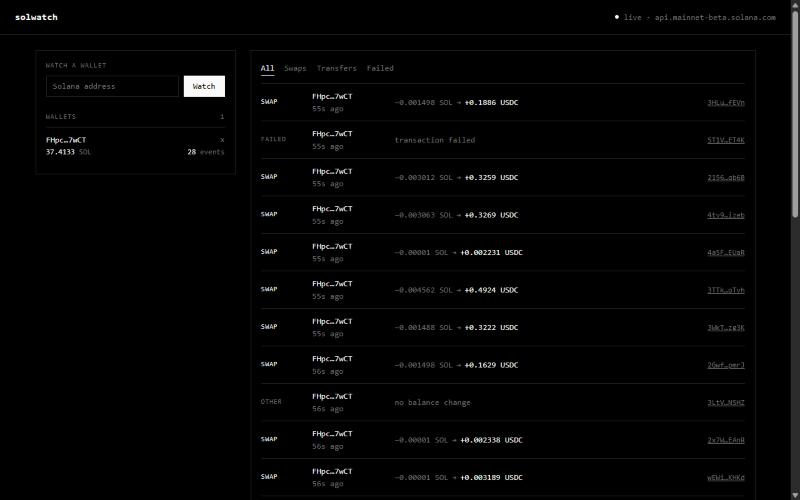

# solwatch

Watches Solana wallets in real time. You add an address and its transfers and swaps show up in a web page as soon as they're confirmed.



It's read-only: no private keys, nothing gets signed or sent.

## What it does

- streams activity over WebSocket (`logsSubscribe` + `accountSubscribe`), no polling
- tells swaps, incoming/outgoing transfers and failed txs apart
- counts wrapped SOL as SOL and leaves the network fee out of the amounts
- shows the live SOL balance of each wallet, the feed can be filtered by type or wallet
- pulls the last few transactions when you add a wallet so the feed isn't empty
- reconnects and resubscribes if the RPC socket or the browser drops

There's no Solana SDK in here. `@solana/web3.js` v1 pulls in packages with known vulnerabilities, so I wrote a small JSON-RPC client and a base58 decoder for address checks instead.

## Running it

```bash
git clone https://github.com/wellkyc/solwatch.git
cd solwatch
npm install
npm start
```

Then go to http://localhost:8787. You need Node 20.12 or newer.

## Config

Copy `.env.example` to `.env` if you want to change anything:

| Variable | Default | |
| --- | --- | --- |
| `PORT` | `8787` | port for the page and the WebSocket |
| `RPC_URL` | `https://api.mainnet-beta.solana.com` | Solana RPC |
| `WS_URL` | same as `RPC_URL` with `ws://` | Solana WebSocket |
| `WALLETS` | | addresses to watch on startup, comma-separated |
| `HISTORY_LIMIT` | `15` | how many past txs to load per wallet |

The public mainnet RPC rate-limits hard and you'll see 429s on busy wallets. Helius, QuickNode and Triton all have free plans that work better.

## How it works

`stream.ts` keeps one WebSocket to the RPC and subscribes to logs and account changes for every wallet. A log notification only has the signature, so `watcher.ts` fetches the full transaction through `rpc.ts`. `parser.ts` compares the wallet's SOL and token balances before and after the tx and decides if it was a swap, a transfer or something else. `index.ts` keeps the last 500 events and pushes new ones to every open browser tab.

The frontend in `web/` is plain TypeScript built with Vite.

## Scripts

- `npm start` builds the page and starts the server
- `npm test` runs the parser tests
- `npm run typecheck`
- `npm run dev:server` and `npm run dev:web` for working on it with reload

## License

MIT
